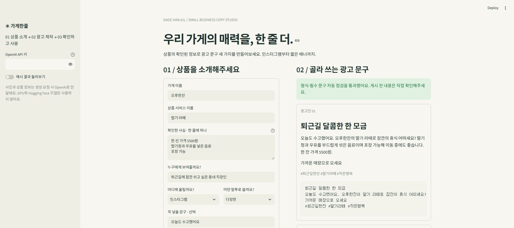
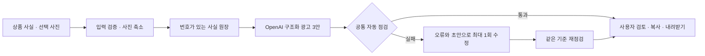

# 가게한줄

> 상품의 확인된 정보로 **우리 가게의 광고 문구 세 가지**를 만드는 소상공인용 서비스입니다.

인스타그램·문자 초안·배너 중 채널을 고르고, 상품 정보와 원하는 말투를 입력하세요. 문구 생성부터 자동 점검, 복사와 내려받기까지 한 화면에서 사용할 수 있습니다. 상품 사진은 선택 사항입니다.



## 바로 확인할 자료

- **[프로젝트 보고서 PDF 내려받기](output/pdf/project_report.pdf)** · [보고서 본문](docs/report.md)
- **[Notion 업무일지](https://app.notion.com/p/40f9556c393781c4b32fc59623f10894)** · [업무일지 PDF 사본](output/pdf/worklog.pdf)
- [실험 원본과 점수](experiments) · [고정 평가 설계](docs/experiment_plan.md) · [생성 문구 직접 검토](docs/manual_review.md)

Notion은 페이지 접근 권한이 필요할 수 있어 PDF 사본도 제공합니다. 업무일지는 실제 수행일인 **2026-11-05**의 작업을 요청에 따라 11월 1~5일 단계로 나눈 회고입니다.

## 무엇을 할 수 있나요?

| 하고 싶은 일 | 입력 | 결과 |
|---|---|---|
| 우리 가게 광고 쓰기 | 상품명·가격 등 확인 사실·대상·말투 | 서로 다른 광고 3안 |
| 채널에 맞게 쓰기 | 인스타그램 / 문자 / 배너 | 채널별 길이와 태그를 적용한 초안 |
| 원하는 표현 조정 | 필수 문구·금지어·분위기 | 조건을 반영한 문구와 점검 결과 |
| 상품 사진 참고하기 | JPG·PNG·WEBP 사진 1장 | 색·모양·구도를 참고한 문구 |
| 결과 가져가기 | 결과 카드 | 복사, Markdown·JSON 내려받기 |

**OpenAI API만 사용합니다. GPU·Hugging Face 모델·Colab은 필요하지 않습니다.** 실제 생성에는 본인의 OpenAI API 키와 사용 가능한 `gpt-5-mini` 권한이 필요합니다. 화면의 **예시 결과 둘러보기**는 키 없이 저장된 결과를 보여주며 API를 호출하지 않습니다.

## 빠른 시작

### 1. 저장소 받기

```powershell
#@title 저장소 받기
#@markdown 내 컴퓨터에 실행 코드를 내려받고 프로젝트 폴더로 이동해요.
git clone https://github.com/kim-tae-yoon-0718/gage-hanjul.git # 프로젝트 내려받기 도구
cd gage-hanjul # 프로젝트 폴더로 이동하는 도구
```

### 2. 실행 환경 만들기

Python 3.10 이상이 필요합니다. 검증 환경은 Python 3.10이며, 명령은 **프로젝트 루트 폴더**에서 실행하세요.

Windows PowerShell:

```powershell
#@title Windows 실행 환경 준비
#@markdown 독립된 실행 환경을 만들고 앱과 검증 도구를 설치해요.
python -m venv .venv # 가상환경 생성 도구
.\.venv\Scripts\python.exe -m pip install -e ".[dev]" # 실행 및 검증 패키지 설치 도구
```

macOS·Linux:

```bash
#@title macOS와 Linux 실행 환경 준비
#@markdown 독립된 실행 환경을 만들고 앱과 검증 도구를 설치해요.
python3 -m venv .venv # 가상환경 생성 도구
.venv/bin/python -m pip install -e ".[dev]" # 실행 및 검증 패키지 설치 도구
```

실험 당시 패키지 버전은 [requirements-lock.txt](requirements-lock.txt)에 보존했습니다. 추가 데이터 파일이나 모델 가중치를 받을 필요는 없습니다.

### 3. API 키 설정

앱 왼쪽의 **OpenAI API 키** 칸에 입력하거나, `.env.example`을 `.env`로 복사한 뒤 `OPENAI_API_KEY`에 본인 키를 넣으세요. 둘 중 한 가지 방법이면 됩니다. 키를 입력하는 코드나 실제 키를 GitHub에 올리지 마세요. `.env`는 업로드 제외 대상입니다.

Windows에서 설정 파일 만들기:

```powershell
#@title 로컬 키 설정 파일 준비
#@markdown 예제 설정을 복사해 본인 키를 적을 파일을 만들어요.
Copy-Item .env.example .env # 비공개 설정 파일을 만드는 도구
```

`OPENAI_MODEL` 기본값은 `gpt-5-mini`입니다. 모델을 임의로 바꾸지 않고 비교했습니다. API 계정의 허용 모델과 잔액은 직접 확인해주세요.

### 4. 화면 열기

```powershell
#@title 광고 제작 화면 실행
#@markdown 로컬 브라우저에서 상품 정보를 입력하고 광고를 만들 수 있어요.
.\.venv\Scripts\python.exe -m streamlit run app.py # 로컬 제작 화면 실행 도구
```

macOS·Linux에서는 실행 경로를 `.venv/bin/python`으로 바꾸세요. 터미널에 표시된 주소(기본 `http://localhost:8501`)를 열면 됩니다. 인터넷에 공개 배포하는 서비스가 아닌 로컬 앱입니다.

## 실제 사용 순서

1. **가게·상품 이름**을 적습니다. 상품명은 광고안마다 입력 원문 그대로 들어가도록 요청하고 점검합니다.
2. **확인한 사실**을 한 줄에 하나씩 적습니다. 예: `한 잔 5500원`, `딸기청과 우유 사용`, `포장 가능`.
3. 대상 고객, 채널, 말투를 고릅니다. 원하는 분위기, 꼭 넣을 문구, 피할 표현도 적을 수 있습니다.
4. 사진을 참고하려면 5MB 이하의 JPG·PNG·WEBP 한 장을 올립니다. 사진 없이도 실행됩니다.
5. **광고 문구 3개 만들기**를 누릅니다. 문제가 탐지되면 최대 한 번 자동 수정하므로 기다리는 시간이 늘어날 수 있습니다.
6. 광고 3안과 **확인 사항과 사용한 사실 보기**를 읽습니다. `수정 필요`가 남으면 입력을 조정하고 다시 만들거나 문구를 직접 편집하세요.
7. 카드의 원문을 복사하거나 **문구 내려받기 (.md)**, **점검 내역 내려받기 (.json)**를 사용합니다.

현재 화면의 입력을 바꾼 것만으로 기존 결과가 다시 생성되지는 않습니다. 상세 영역에서 **그 결과를 만들 때 사용한 입력**을 확인할 수 있습니다. 예시 모드에서는 저장된 예제를 보여주므로 실제 생성 결과를 보려면 예시 모드를 끄세요.

## 터미널에서 사용하기

[examples/cafe.json](examples/cafe.json)을 수정하거나 같은 형식의 JSON을 준비하세요. `facts`는 1~8개, 각 160자 이하입니다. `forbidden_words`는 최대 10개입니다. 필수 문구와 금지어가 겹치면 생성 전에 알려줍니다.

```powershell
#@title 상품 정보로 광고 만들기
#@markdown 광고 Markdown과 전체 점검 JSON을 .local 폴더에 저장해요.
.\.venv\Scripts\python.exe -m gage_hanjul.cli --brief examples/cafe.json --out .local/my-ad # 최종 방식으로 광고를 만드는 도구
```

사진을 함께 사용할 때:

```powershell
#@title 사진을 참고한 광고 만들기
#@markdown 사진의 외형을 참고해 문구와 점검 결과를 저장해요.
.\.venv\Scripts\python.exe -m gage_hanjul.cli --brief examples/cafe.json --image examples/product-test.png --out .local/photo-ad # 선택 사진 입력 도구
```

제공한 테스트 그림은 직접 그린 합성 자료이며 실제 상품 사진이 아닙니다. 출력은 `.local/my-ad.md`와 `.local/my-ad.json`입니다. 실패 시 고정 문구로 대체하지 않고 오류를 알립니다.

## 자동 점검이 확인하는 것

| 항목 | 기준 |
|---|---|
| 길이 | 공백을 포함한 Python len, 필드별 기준 적용 |
| 필수 정보 | 상품명·필수 문구 원문 포함 |
| 금지 표현 | 금지어의 띄어쓰기 우회, 일부 효능·보장 표현 |
| 숫자 | 확인 정보에 없는 숫자·단위 조합 |
| 형식 | 광고 3안, 빈 필드, 태그 수·문법, 완전 중복 |
| 근거 번호 | 입력 사실 번호의 유효 범위 |

채널의 제목/본문/행동 유도 최대 길이는 인스타그램 `30/220/30`, 문자 `20/90/20`, 배너 `16/45/12`자입니다. 해시태그는 인스타그램 3개, 나머지 0개입니다. **이 기준은 서비스 내부 기준이며 실제 광고 플랫폼 규격·문자 발송 요건을 대신하지 않습니다.**

자동 점검은 의미 전체의 사실성이나 광고 적법성을 보장하지 않습니다. 사진으로 원산지·재료·가격을 추정하지 않도록 지시하지만 사용자가 최종 확인해야 합니다. 실제로 자동 점검이 놓친 부정확한 커피 태그와 품질 수식어를 [표본 검토](docs/manual_review.md)에 기록했습니다. 문자 발송·광고 게시·이미지 생성은 지원하지 않습니다.

## 처리 구조



수정 후에도 문제가 남으면 화면에 `수정 필요`를 표시합니다. 근거 번호는 모델의 자기 보고이며 문장별 의미 검증 증거는 아닙니다. 키는 로컬 `.env` 또는 현재 앱 입력에서 읽고, API 요청은 `store=false`로 보냅니다. API에 전달하는 사진은 방향 보정·축소·메타데이터 제거를 거칩니다. 앱은 자체 DB를 만들지 않고 CLI만 지정한 출력 파일을 저장합니다.

## 기본 버전과 두 번의 개선 실험

가상 소상공인 6종 × 채널 3종의 **고정 평가 18건을 두 번씩**, 버전별 36묶음으로 비교했습니다. 세 광고안 중 하나라도 공통 기준이나 사실성 표지를 어기면 묶음 전체가 실패합니다. 사용한 모델은 모두 `gpt-5-mini`이며 반환 모델명은 `gpt-5-mini-2025-08-07`입니다.

| 버전 | 바꾼 점 | 전체 통과 | 사실성 표지 통과 | 서비스 36회분 추정 비용 | 호출 시간 중앙값 |
|---|---|---:|---:|---:|---:|
| 기본 | 완성된 생성·점검·UI | 14/36 (38.89%) | 32/36 | $0.037017 | 4.988초 |
| 개선 1 | 번호가 있는 사실 원장 | 18/36 (50.00%) | 36/36 | $0.040105 | 5.450초 |
| **개선 2 · 기본 실행** | 실패 초안만 최대 한 번 수정 | **31/36 (86.11%)** | **36/36** | **$0.063829** | **8.666초** |

두 번째 개선은 첫 실험의 같은 초안을 재사용했습니다. 통과 초안 18개를 유지하고, 실패 초안 18개에만 한 번씩 수정 요청을 보내 그중 13개를 복구했습니다. **5/36 묶음은 여전히 길이·상품명 문제가 남았습니다.** 인스타그램 11/12, 문자 12/12, 배너 8/12가 최종 통과했습니다.

평가셋·검증기·채점기의 SHA-256은 세 단계에서 같습니다. 기본과 개선 1은 새 생성 비교이므로 무작위성·시점 영향이 남습니다. 첫 개선 manifest의 초기 HEAD와 실제 소스 커밋 차이는 [추적 보충 정보](experiments/evidence/provenance.json)에 설명했습니다.

**해석 범위:** 사실성 표지는 미리 정한 문자열 검사입니다. 100%를 모든 사실이 정확하다는 뜻으로 해석하지 않습니다. 개발용 가상 평가이고, 독립 테스트셋·실사용자 만족도·구매 전환을 검증하지 않았습니다. 사진은 정량 비교에서 제외하고 별도 기능 점검을 했습니다. 자세한 실패 사례와 한계는 보고서에 담았습니다.

비용은 실제 토큰 수에 [공식 모델 요율](https://developers.openai.com/api/docs/models/gpt-5-mini)을 적용한 추정입니다. 캐시 할인은 제외했습니다. 마지막 열은 초안 생성과 해당 시 수정 호출 시간의 합에 대한 중앙값입니다. 실험 2 비용은 초안 생성 비용을 포함합니다. **중복 호출을 제거한 정식 비교 실험 총합은 90회, 약 $0.100846**입니다. 별도 CLI·사진·화면 점검 비용은 [기능 검증 기록](verification/summary.json)에 구분합니다. 사용자 GPU는 사용하지 않았습니다.

## 평가 재현과 테스트

저장된 결과를 다시 계산하는 작업은 API를 호출하지 않습니다.

```powershell
#@title 저장된 실험 결과 다시 계산
#@markdown 원본 응답에서 점수·채널별 결과·실제 비용을 다시 집계해요.
.\.venv\Scripts\python.exe scripts/analyze_results.py # 비용 없는 결과 집계 도구
```

실제 API로 다시 실험하려면 별도의 출력 폴더를 사용하세요. 새 응답은 비결정적이므로 제출된 점수와 정확히 같지는 않을 수 있습니다. 실행 시 계정의 모델 접근과 한도를 확인하세요.

```powershell
#@title 기본 버전과 두 개선을 순서대로 재현
#@markdown 고정 사례를 실제로 생성하고 동일 초안에 한 번만 수정해 비교해요.
.\.venv\Scripts\python.exe scripts/run_eval.py --stage baseline --out .local/reproduce/baseline # 기본 버전 36회 생성 도구
.\.venv\Scripts\python.exe scripts/run_eval.py --stage evidence --out .local/reproduce/evidence # 첫 개선 36회 생성 도구
.\.venv\Scripts\python.exe scripts/run_repair_eval.py --source .local/reproduce/evidence/responses.jsonl --out .local/reproduce/repair # 실패 초안만 최대 36회 수정 도구
```

기본·첫 개선은 각각 최대 36회, 마지막은 최대 36회 추가 호출하도록 범위를 제한했습니다. 자동 재시도나 모델 대체는 없습니다. 수정 API가 실패하면 초안의 실패 상태를 유지합니다.

```powershell
#@title 자동 테스트 실행
#@markdown 입력·사진·광고 제약·화면·최대 1회 수정 동작을 API 비용 없이 확인해요.
.\.venv\Scripts\python.exe -m pytest -q # 전체 검증 도구
```

현재 **15개 테스트 통과**. 실제 CLI 생성, 선택 사진 입력, Chrome에서 광고 생성과 JSON 내려받기도 확인했습니다. 이를 실제 소상공인 사용자 실험이나 부하 테스트로 부르지는 않습니다.

## 자주 막히는 부분

| 상황 | 해결 방법 |
|---|---|
| API 키가 없다는 안내 | 앱 왼쪽에 키를 넣거나 프로젝트 루트의 .env를 확인하세요. |
| 인증·모델 접근 오류 | 키 유효성과 해당 계정의 gpt-5-mini 사용 권한을 확인하세요. |
| 사용량 제한(429) | 잔액·요청 제한을 확인하고 잠시 후 다시 시도하세요. 자동 재시도하지 않습니다. |
| 생성 후 수정 필요 | 상세 오류를 읽고 필수 문구를 줄이거나 사실을 정리해 다시 만드세요. |
| 금지어가 필수 문구와 겹침 | 양쪽 중 하나를 바꿔야 생성할 수 있습니다. |
| 사진 오류 | 지원 형식, 5MB·2천만 픽셀 제한과 손상 여부를 확인하세요. |
| 결과가 안 바뀜 | 예시 모드 여부를 확인하고 생성 버튼을 다시 누르세요. |
| 문자가 길거나 발송에 부적합 | 초안만 제공하므로 실제 발송 플랫폼의 표시·바이트·수신거부 요건을 별도로 확인하세요. |

## 저장소 구조

```text
gage-hanjul/
├── app.py                    # Streamlit 제작 화면
├── src/gage_hanjul/           # 입력·API·생성·검증·평가·CLI
├── prompts/                  # 기본·사실 원장·단일 수정 지시
├── data/evalset_v1.jsonl      # 고정 가상 평가 18건
├── experiments/              # 원본 응답·점수·토큰·해시
├── examples/                 # 가상 상품·저장된 결과·합성 테스트 그림
├── verification/             # 실제 기능 점검 기록
├── scripts/                  # 평가·분석·보고서·비밀값 검사
├── tests/                    # 비용 없는 자동 검증
├── docs/                     # 보고서 본문·실험 설계·검토 기록
└── output/pdf/               # 최종 보고서·업무일지 PDF
```

## 참고와 범위

[기존 팀 저장소](https://github.com/kim-tae-yoon-0718/ai12-team02)의 사용법 중심 README와 문제 정의·병목·개선·최종 구조의 보고 흐름을 참고했습니다. 이번 소스·가상 평가 자료·실험 수치는 새로 작성·실행했습니다. 영상은 만들지 않았습니다. 자동 게시와 클라우드 배포는 범위에 포함하지 않습니다.
